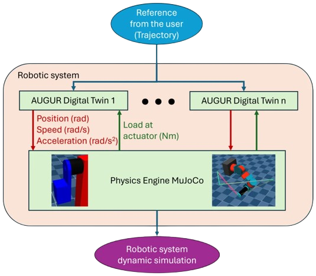

AUGUR Digital Twin
{ .pulsar-home-eyebrow }

# AUGUR Digital Twin

AUGUR Digital Twin provides validated virtual models of PULSE actuators for software development, controller testing, and robot co-simulation.
The same control algorithms run at 20 kHz in the digital twin and in the physical actuator firmware.
The software interfaces are designed to let PULSAR HRI Virtual and Real actuators be controlled using the same function calls.

## Differences between virtual and real actuators

The remaining differences reflect how virtual and physical actuators operate:

- **Initialization and communication:** Initialize a virtual actuator in software; connect a real actuator and communicate with it over its data bus.
- **External load:** A real actuator experiences the load applied to its shaft. In a virtual simulation, pass the load explicitly (for example, from a physics engine) or choose a load for the simulation.

## How it fits together

- `pulsar-assets` installs prebuilt model libraries.
- `VirtualWorld` owns one deterministic simulation clock.
- `PulsarActuatorVirtual` exposes the same lifecycle, modes, commands, grouping, status, and safety concepts as a physical actuator.

In addition if you have a platform and you want to simulate it directly without managing the dynamics/load calculations, then: 
- An `external multibody simulator` like MuJoCo, Newton, Gensis-World, or Gazebo own robot links, contacts, constraints, and other coupled dynamics, check [co-simulation](co_sim_coupling.md).

## Supported actuator models

- P90
- P100
- PULSE98-30G
- PULSE98-55G
- PULSE115-60G
- PULSE115-110G

## Start here

- [Virtual actuator with Pulsar Python SDK](../quickstart/sdk_virtual.md)
- [Virtual actuators in Pulsar Python SDK](../sdk/virtual_actuators.md)
- [Co-simulation coupling](co_sim_coupling.md)
- [Robot modelling](robot_modelling.md)

## Model ownership

A virtual actuator model contains actuator plant and controller behavior. Coupled robot geometry and dynamics belong to the external simulator. Do not integrate the same joint mechanics in both systems.

## Publication

For a more detailed description and experimental validation of actuator digital twins, see the open-access paper by the PULSAR HRI research team, [“Actuator Digital Twins for Predictive Robotic Simulation: Experimental Validation and Multi-DOF Scalability”](https://www.mdpi.com/2076-0825/15/8/451).

The authors are Iván Jesús Torres Rodríguez, Michele Ghilardi, Jordi Marsà Fargas, Añaterve Oval Trujillo, Daniel Sanz Merodio, Jonay Tomás Toledo Carrillo, and Miguel López Estévez.

*General architecture of a robotic system integrated with actuator Digital Twins. [Figure 4 from the paper]*
