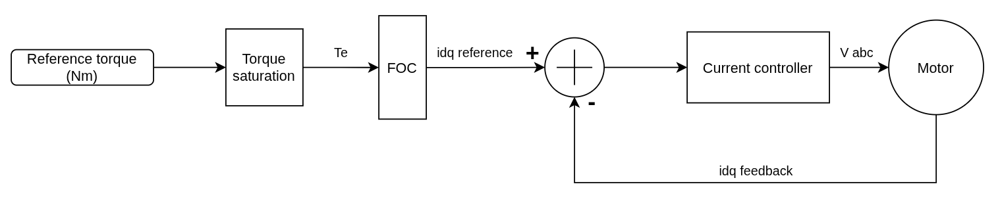
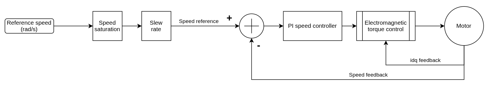
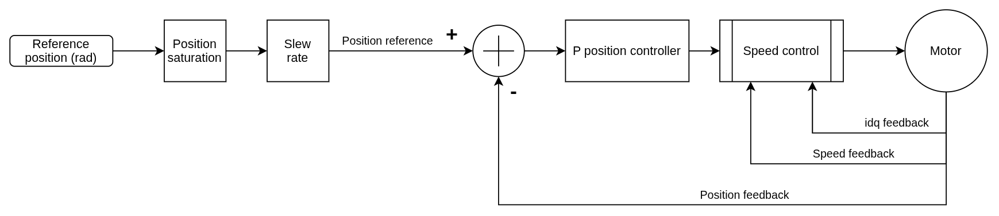
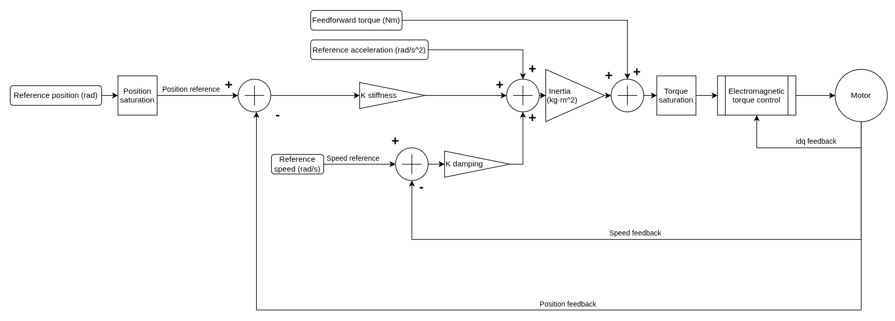

# Control architectures

PULSE actuators provide four user-facing control modes. The same low-level behavior is used by physical firmware and AUGUR Digital Twin models.

| Mode | Pulsar SDK enum | Primary command |
| --- | --- | --- |
| Torque control | `Mode.TORQUE` | torque in N·m |
| Speed/velocity control | `Mode.VELOCITY` | angular velocity in rad/s |
| Position control | `Mode.POSITION` | output position in rad |
| Impedance control | `Mode.IMPEDANCE` | position in rad plus optional impedance fields |

Pulsar App labels velocity mode as **Speed Control**. Pulsar SDK uses the more precise enum name `VELOCITY`.

## Torque

The command is converted to field-oriented current references and regulated by the motor current loop, subject to configured limits.

## Velocity

An outer proportional-integral velocity loop produces the torque request for the inner torque/current control loop.

## Position

An outer position controller generates a velocity request for the nested velocity and torque loops.

## Impedance

Virtual stiffness, damping, inertia, and feedforward terms produce a compliant torque request from position and velocity behavior.

For valid command fields and persistent parameters, continue with [Control parameters by mode](parameters.md).
