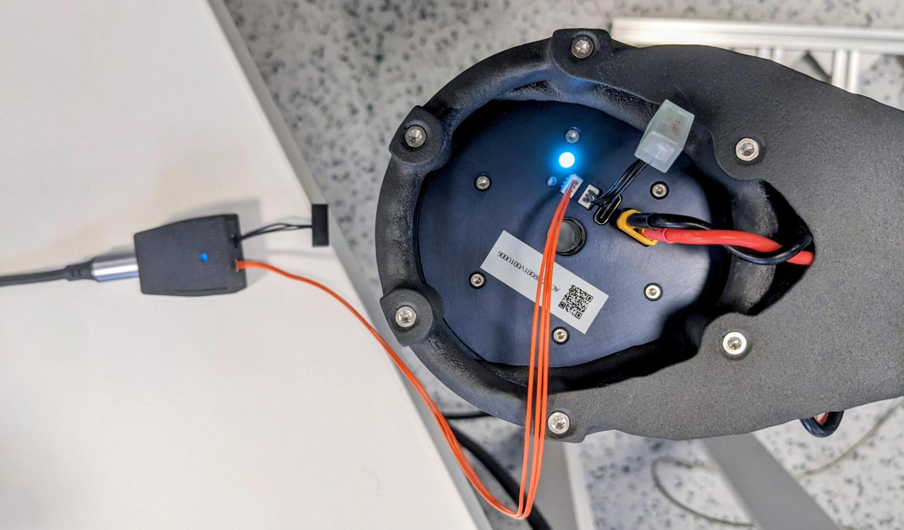
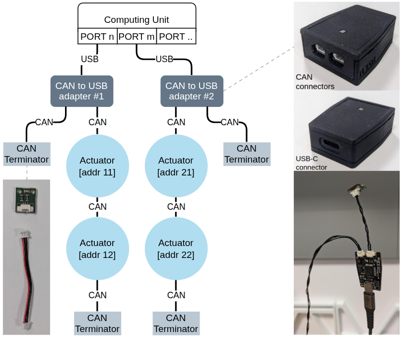

Hardware
{ .pulsar-home-eyebrow }

# CAN FD

CAN FD connects one or more PULSE actuators to a computer through a USB-to-CAN adapter.

## Required hardware

- one Pulsar USB-to-CAN adapter;
- one USB cable for the adapter;
- CAN cables with compatible 3-pin Molex PicoBlade connectors;
- one 120 Ω termination resistor at each physical end of the bus;
- powered, securely mounted actuators with unique addresses.

See [Electrical interfaces](../electrical_interfaces.md) for connector and pinout details.

## Wire one actuator

1. Connect the adapter to the computer.
2. Put one termination resistor on one adapter CAN port.
3. Connect the other adapter CAN port to either actuator CAN port.
4. Put the second termination resistor on the actuator's unused CAN port.



CAN ports are bidirectional. The termination resistors must remain at the two physical ends of the complete bus.

## Discover addresses

Install Pulsar Python SDK, then scan the bus:

```bash
pulsar-cli scan
```

The default scan range is 16–255. Valid actuator CAN addresses are 16–16382.

## Add actuators

Daisy-chain additional actuators and keep only two termination resistors, one at each physical end. Every actuator on one `PcpOverCan` domain must have a unique address.

More than eight registered actuators is allowed, but is not recommended for stability and to get the most performance. Request only the telemetry required by the application and use the [CAN bus utilization tool](can_bus_utilization.md) to estimate your utilization before increasing actuator count or rates.

## Planning multiple buses

Actuators on one CAN FD bus share its communication capacity. For larger systems, consider distributing actuators across independent buses, each with its own compatible USB-to-CAN adapter, subject to host USB-port availability. Plan each bus separately for command and telemetry traffic, physical wiring, and electrical loading.

Use the [CAN bus utilization tool](can_bus_utilization.md) to estimate communication utilization. This estimate does not establish electrical compatibility or guarantee real-time performance. Each independent bus must retain termination at both physical ends; see [Wire one actuator](#wire-one-actuator) for the termination arrangement.



*The shown node count and addresses are examples, not a product limit. The exposed adapter board is shown for identification only; do not remove an enclosure or operate a board unenclosed to avoid interference at high communication speeds.*

## Data-rate switching

CAN FD can use a 5 Mbit/s data phase. Treat bit-rate switching as a bus-wide configuration: all devices on the bus must be compatible and configured consistently.

## Troubleshooting

### Adapter not detected

- reconnect the adapter;
- try another USB cable or port;
- pass the serial port explicitly;
- check operating-system serial permissions.

### No actuator found

- confirm actuator power;
- check CAN_H, CAN_L, and ground wiring;
- verify both termination resistors;
- try a smaller scan range around known addresses;
- replace worn-out cables.

If the problem persists, [contact support](../../support.md).
