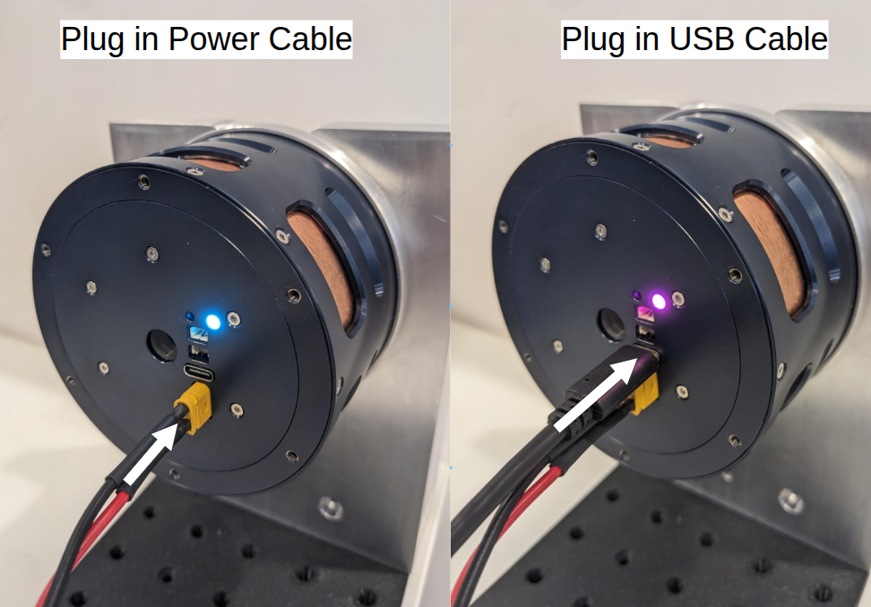

# Direct USB

Direct USB is the simplest physical connection for one actuator.

## Connect

1. Complete [Actuator setup](../actuator_setup.md).
2. Connect the actuator directly to the computer using USB-A to USB-C.
3. Confirm that the LED indicates USB communication.

## Verify

Use either:

- [Pulsar App](../../pulsar_app/browser.md); or
- Pulsar SDK with `PcpOverUsb` and actuator address `0`.

The SDK and CLI auto-detect the port when possible. If several Pulsar serial devices are connected, pass the port explicitly.

## Continue

- [Single actuator with Pulsar App](../../quickstart/pulsar_app.md)
- [Single actuator with Pulsar SDK](../../quickstart/sdk_usb.md)
- [Direct USB with Pulsar SDK](../../sdk/physical/usb.md)
