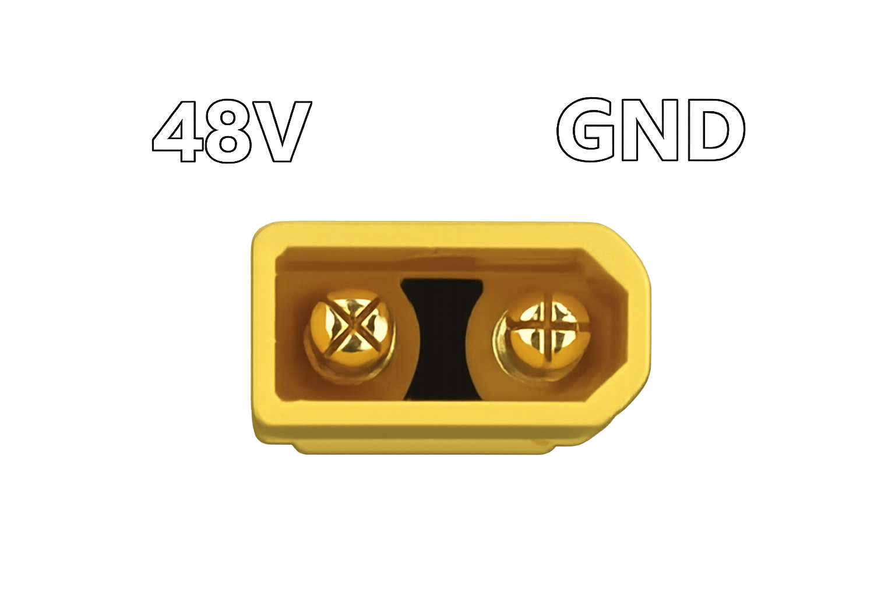
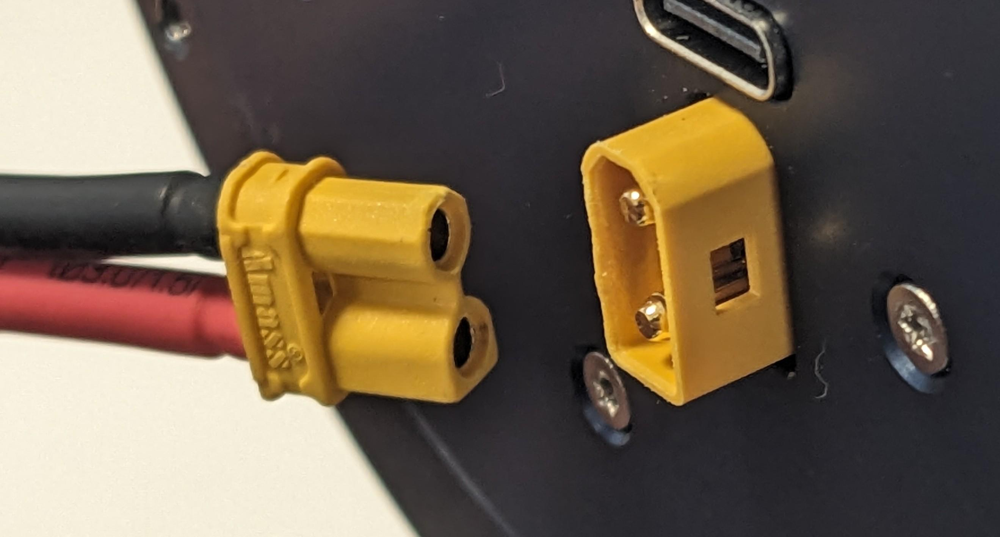
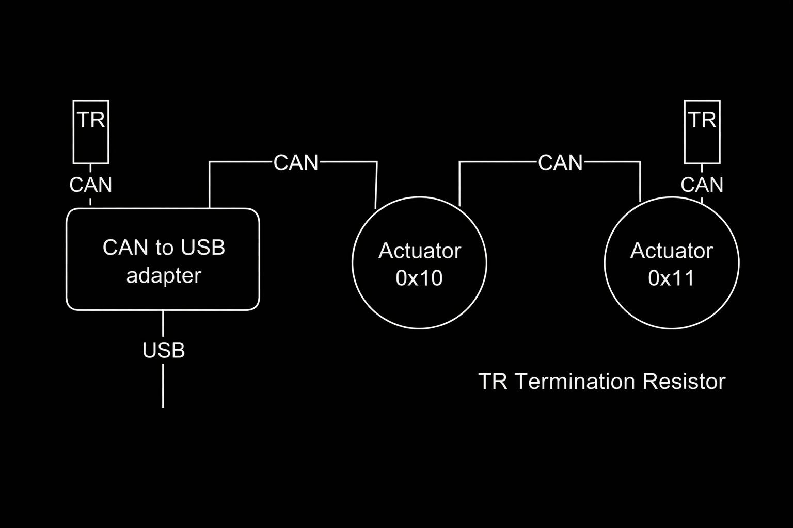
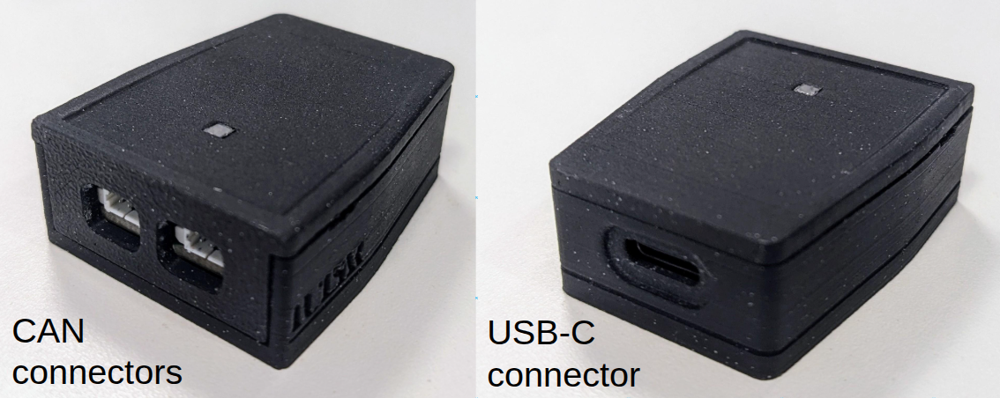
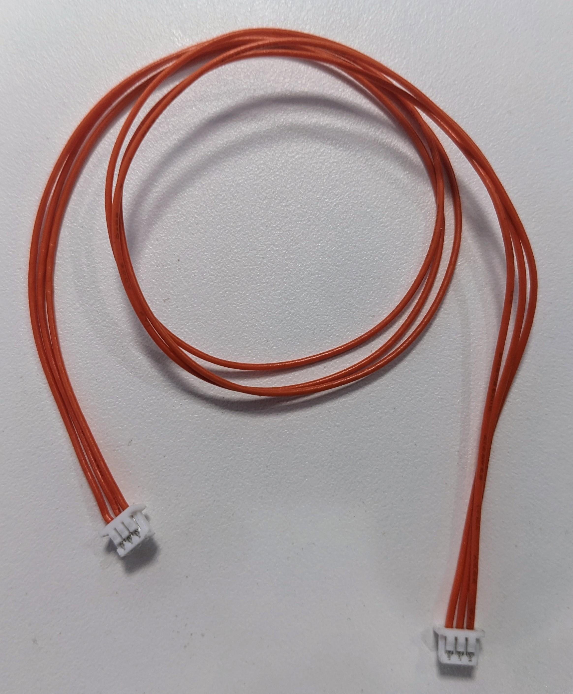
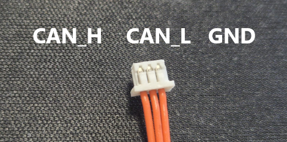
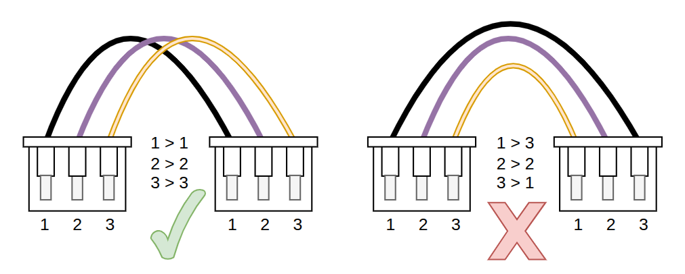
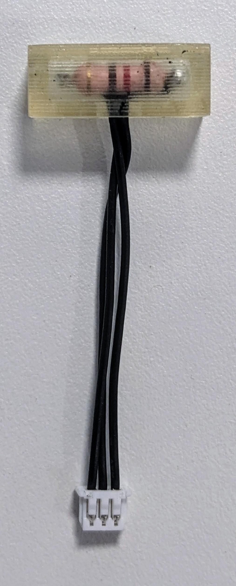

# Electrical interfaces

## Power bus

- Voltage: **48 V DC**
- Current: up to **30 A**
- Actuator connector: **XT30 male**

Actuators usually draw much less than the maximum current without load, but the supply and wiring must be suitable for the configured limits and application. If the supply cannot provide the possible demand, configure an appropriate current or torque limit.

### Power cable

The actuator requires an XT30 female connector on the power cable.

  

{ width="50%" }

!!! danger
    Verify polarity before applying power. Incorrect wiring can damage equipment and create a fire or injury hazard.

## USB

The actuator USB connector supports direct connection to one computer for configuration, single-actuator testing, control, and maintenance. Use a standard USB-A to USB-C cable.

Direct USB uses actuator address `0` in Pulsar Python SDK.

## CAN FD

PULSE actuators support CAN FD with a 1 Mbit/s arbitration rate and selectable 1 or 5 Mbit/s data phase. Dual CAN connectors allow daisy chaining.

### USB-to-CAN adapter

A CAN adapter connects the host computer to the actuator bus. PulsarHRI provides a USB-to-CAN adapter.

### CAN cables

Compatible cables use 3-pin Molex PicoBlade connectors.

{ width="50%" }

Preserve the pinout at both cable ends:

### Termination

Place one 120 Ω termination resistor at each physical end of the CAN bus.

{ width="30%" }

Continue with [CAN FD connectivity](connectivity/can.md).
