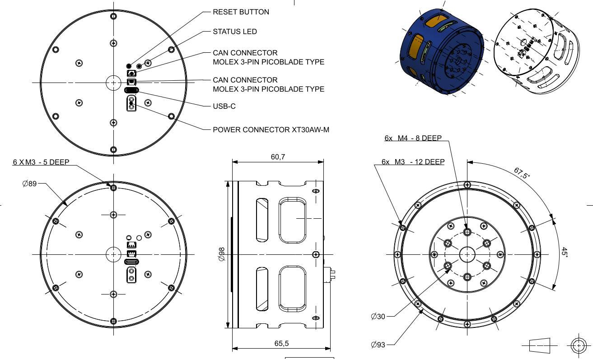
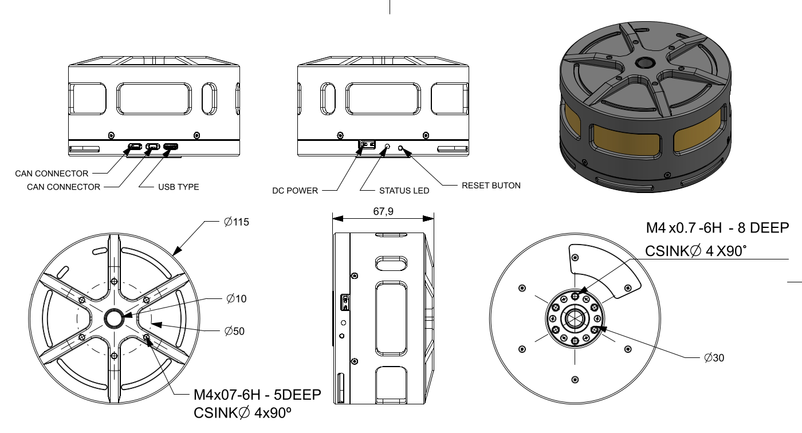

# Mechanical interfaces

Check the actuator mounting interfaces before designing brackets, fixtures, or robot integrations.

## PULSE98

The public PULSE98 STEP assembly will be added to [Mechanical CAD and printable fixtures](../resources/cad.md) when available.

## PULSE115

A merged PULSE115 STEP assembly is available under [Mechanical CAD and printable fixtures](../resources/cad.md).

## Integration checklist

- support the actuator body against expected reaction torque;
- use suitable fasteners and engagement depth;
- check output travel and collision envelopes;
- provide strain relief for power and communication cables;
- validate the complete mechanism before increasing speed, torque, or gains.
