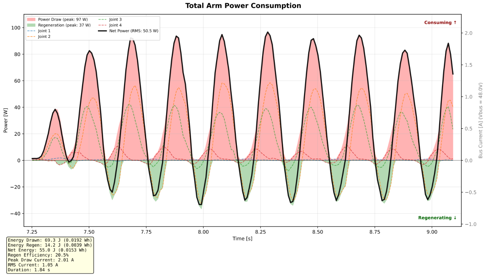
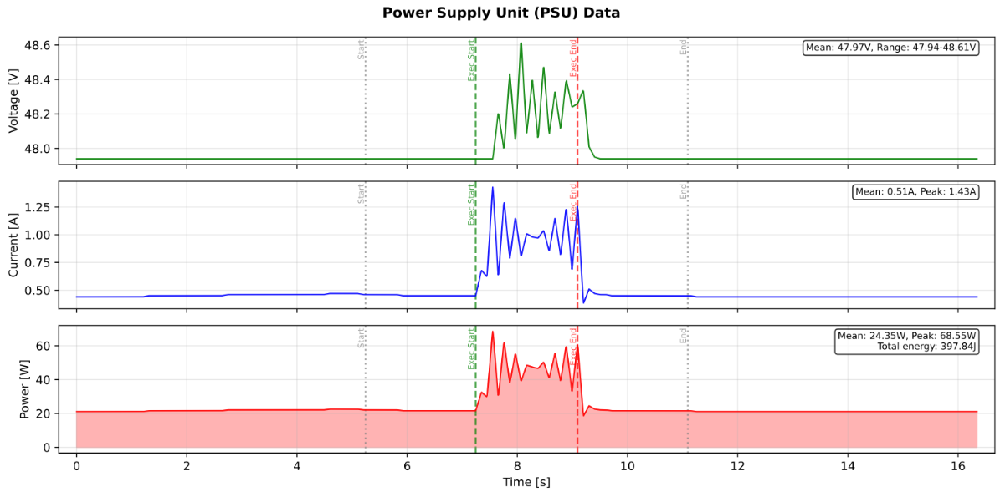
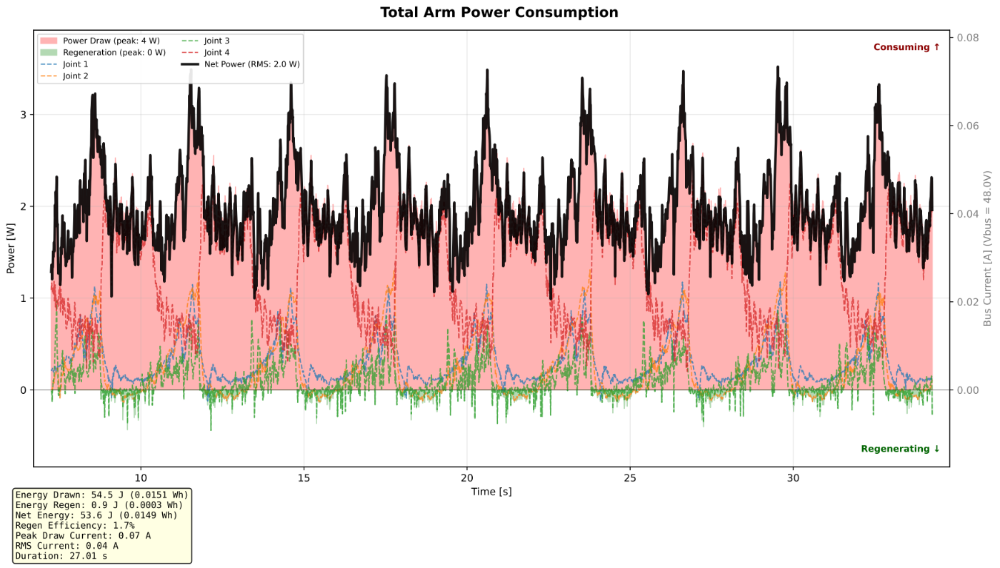
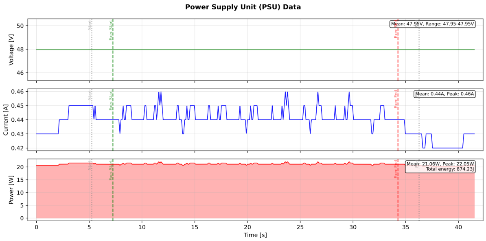

Hardware
{ .pulsar-home-eyebrow }

# Regenerative energy management

> **TL;DR**
>
> PULSAR actuators can return energy to the DC bus during braking. Provide an appropriate way to absorb this energy when designing the power system, and monitor bus voltage during operation.
>
> A conventional 48 V Power Supply Unit (PSU) is not necessarily able to absorb returned energy but should be enable to start running conservative tests at a minimum. Any initial testing must be assessed for the complete system: start with small, slow movements, monitor bus voltage, and increase dynamics gradually.
> The specific research tests documented below completed on a 4dof with conventional PSU without any observed damage, including for very high dynamics as shown; this is not assurance for other setups.

PULSAR QDD actuators operate from a nominal 48 V DC supply. In a multi-actuator system, they are often connected to a shared DC bus, depending on the system power architecture.

The actuators use quasi-direct drive (QDD) transmissions with low reduction ratios, making them highly backdrivable. During deceleration or externally driven motion, the motor can act as a generator and return electrical energy to the DC bus. The bus voltage then depends on what the other actuators consume, what the supply or battery can absorb, and whether the system has a braking path.

This page explains power-up, bus-voltage behavior, and practical ways to manage regeneration. The numerical values below refer to the **PULSE115-60G** and provide general, initial guidelines.

Check the specifications and firmware settings applicable to your actuator and system.

See [Electrical Interfaces](electrical_interfaces.md) for the 48 V power connector and general bus requirements.

## DC-bus characteristics and power-up

| Characteristic | PULSE115-60G value or behavior |
| --- | --- |
| Nominal supply | 48 V DC |
| Total nominal input capacitance | Approximately 163 µF per actuator |
| Equivalent capacitor ESR | Approximately 700 µΩ |
| Built-in precharge or active inrush limiting | None |
| Undervoltage / overvoltage fault limits | 30 V / 60 V, preset in firmware and not user configurable |
| Control electronics power | Supplied from the same 48 V input; no separate logic input |
| Typical disabled current | Approximately 100 mA |
| Typical enabled current at zero command, with no active control | Approximately 150 mA |

!!! warning "Safety"
    Regenerated energy can raise the DC-bus voltage. Do not assume a conventional supply can absorb current, and do not treat the test results on this page as a system rating or guarantee. Use a suitable energy-management path and monitor the bus during staged testing.

**Precharge external switched power rails.** Connecting an uncharged actuator directly to a stiff source can produce an inrush transient. A peak current and duration for direct, uncontrolled connection have not been characterized. A connector with an anti-spark resistor, such as the XT90-S used in some system builds, helps during manual connection; it is not a replacement for a designed precharge path in a relay-switched distribution board.

For an illustrative 48 V rail, a **1.8 kΩ** series precharge resistor and a single actuator's nominal **163 µF** input capacitance give:

- Initial current: `I₀ ≈ 48 V / 1.8 kΩ = 26.7 mA`.
- Ideal time constant: `τ = RC ≈ 0.293 s`.

In the *ideal RC model*, five time constants are about **1.47 s** and bring the capacitor to approximately 99.3% of the source voltage. The resistor initially dissipates approximately **1.28 W**, then less as charging proceeds.

These are estimates, not a validated relay-bypass delay or resistor rating. Size the pulse-energy and power rating for the actual source, wiring, number of actuators, and repeated connection cycle; confirm the actuator-side bus voltage before closing the bypass.

Additional bus capacitance and electronics powered during precharge can change the measured charge time. The capacitor stores approximately **0.19 J** at 48 V, so its capacitance alone should not be treated as a sustained braking-energy sink.

Removing 48 V turns off the actuator, including its control electronics. Allow the internal capacitors to discharge safely before reconnecting power.

This information does not establish a specific CAN/USB connection order or automatic restart behavior after a power interruption; validate the intended sequence in the complete system.

## What happens during braking

When mechanical energy drives the motor, electrical power can flow back through its drive to the shared DC bus. An individual joint can regenerate while the *whole arm* still consumes power: other joints and electronics can use the returned energy locally.

If the total returned power exceeds the loads' consumption and the supply cannot sink current, the bus voltage can rise. A one-quadrant bench supply generally sources current but should not be assumed to absorb returned current.

As of the end of 2026, our actuators have **no built-in brake chopper or braking resistor**. Design the external power system so regenerative energy has a suitable destination, such as:

- A supply explicitly rated to sink the expected current and energy.
- An external, voltage-controlled brake chopper with a correctly sized braking resistor.
- A battery and battery-management path rated to accept the returned charge under the actual state-of-charge, temperature, and fault conditions.
- Other actuators or loads on the same bus, where their concurrent consumption is verified for the operating envelope. Shared loads may reduce the net returned energy, but are not a guaranteed sink at every instant.

Select the braking turn-on level and protective limits using the whole system's wiring and transient response. The actuator's fault limits set in firmware are **30 V** and **60 V** for the PULSE115-60G.

Voltage warnings have also been described around the **45 V and 53 V** boundaries; the exact warning behavior, hysteresis, sampling point, and recovery conditions should be checked for the installed firmware. Do not use a warning indication as the sole design margin for a brake chopper.

If a voltage-related fault appears while an external meter reports a lower peak bus voltage, capture the bus voltage at the actuator terminals with adequate bandwidth and correlate it with the drive's fault record. A slow measurement at the PSU can miss a local or brief excursion, and the available values alone do not establish the fault's cause.

For example, an observed rise from **48.2 V to 52.2 V over 0.2 s** during approximately **35 W** of braking does not by itself demonstrate that the documented **60 V** overvoltage limit was reached. Confirm the particular fault condition before changing the power architecture.

## Pulse Arm 4DOF: measured dynamic example

An appropriate way to absorb regenerated energy is recommended when designing the power system. In our experience, conventional power supplies can also support initial testing and non-extreme operation without a dedicated regeneration system.

We have extensively tested platforms built with our actuators using many power supplies, from expensive laboratory units to inexpensive hobby-level models, as well as batteries. In our internal testing to date, we have not damaged an actuator or power supply during operation, including tests with aggressive dynamics like the fast trajectory shown below.

Start with small, slow movements and gradually increase the operating range and dynamics while observing actuator behavior and the DC bus voltage. Assess the specific power source, loads, wiring, and motion before increasing speed or acceleration.

Regenerative behavior depends on the complete system, so our experience does not guarantee the same outcome in every setup.

**Disclaimer:** PULSAR HRI is not liable for damage to power electronics resulting from the use of this guidance or the operation of a system without a dedicated means of managing regenerated energy.

### Methodology

The following example uses a four-joint Pulse Arm with **2 × PULSE115-60G** and **2 × PULSE98-30G** actuators on a shared 48 V bus. The supply used for these experiments was an **EA-PS 9200-25 T, 1500 W**.

The high-level controller **streams a precomputed joint-position trajectory at 100 Hz**, open loop at the arm level, without gravity compensation or other high-level feedback. Each actuator runs its **local position control at 20 kHz**, with joint-level control gains set using the digital twin and empirical testing to achieve adequate tracking without instability.

| Joint | Actuator model | `POSITION_KP` | `VELOCITY_KP` | `VELOCITY_KI` |
| --- | --- | ---: | ---: | ---: |
| J1 | `PULSE115-60G` | 16.0 | 0.6 | 3.0 |
| J2 | `PULSE115-60G` | 16.0 | 0.6 | 4.0 |
| J3 | `PULSE98-30G` | 16.0 | 0.2 | 6.4 |
| J4 | `PULSE98-30G` | 16.0 | 0.4 | 6.4 |

The gains are the values used for this experiment; suitable gains depend on the actuator model, payload, and system dynamics.

The 100 Hz CAN stream sends joint position commands from the central computing unit (a standard laptop), while each actuator executes its local cascaded position and FOC current loops at 20 kHz (POSITION control mode). For an overview of control modes available on the actuators, see [Control](../control_architectures/index.md).

In the joint power plots, positive power indicates electrical consumption (motoring), while negative power indicates electrical regeneration (braking). The plotted joint traces represent the **instantaneous aggregate electrical power per actuator** (`Pelec = 3/2 (v_d i_d + v_q i_q)`, computed onboard at 20 kHz from measured shunt currents and commanded `dq` voltages, then streamed at 100 Hz as `BUS_POWER`). They do **not** represent individual raw AC phase waveforms.

Total energy from the joint plots should not be directly equated with external bench PSU measurements. Joint telemetry captures motor electromechanical conversion and excludes the ~3–5 W per-actuator baseline electronics consumption. The PSU is sampled at a lower rate (10 Hz vs. 100 Hz), and its logging window spans the entire run rather than the segmented trajectory window.

### Results

#### Fast, aggressive trajectory

The fast run, identified as `y_axis/accel_40p0/v_max_2p0`, produces repeated reversals, with some joints returning energy while others draw it. The joint-power window is **1.84 s** long.

The plot reports a **97 W** peak draw, a **37 W** peak regenerative magnitude, **69.3 J** of gross positive energy, **14.2 J** of gross returned energy, and **55.0 J** net positive energy. Its reported regenerative fraction, **20.5%**, is 14.2 J divided by 69.3 J for this window; it is not an end-to-end energy-recovery efficiency.

*Fast run, joint-side power. The black line is the total of the joint traces; green shading marks intervals when its sign is regenerative. Power and energy values are specific to the displayed 1.84 s window.*

The one-quadrant PSU remained a net source in this example. Its plotted voltage ranges from **47.94 V to 48.61 V**, and its supply-side power peaks at **68.55 W**.

The plot reports **397.84 J** over its full approximately **16 s** record, including the idle periods before and after the movement. Its current trace stays positive at the displayed resolution.

Those observations are consistent with regenerated energy being used elsewhere on the shared bus or temporarily stored, but they do not measure the precise destination of each returned joule.

*Fast run, PSU-side voltage, current, and power. The green and red vertical lines mark the execution window in the full recording.*

The test completed on a standard one-quadrant supply without observed damage to the supply or actuators. This is a result for this configuration and motion, not a guarantee for a different trajectory, load, bus capacitance, or supply.

#### Slow comparison trajectory

The slow run is identified as `y_axis/accel_40p0/v_max_0p1`. In the **27.01 s** joint-power window, the plot reports **54.5 J** drawn, **0.9 J** regenerated, **53.6 J** net energy and a **1.7%** regenerative fraction.

Peak draw is shown rounded to **4 W**, and peak regeneration is shown rounded to **0 W**. Individual joint traces briefly go negative while the total arm trace remains positive at the displayed resolution.

The longer window means its energy totals should not be compared directly with the fast run's 1.84 s window.

*Slow run, signed joint power and total arm power.*

The PSU plot reports a **47.95 V** bus throughout the recording at its displayed precision, a **22.05 W** peak supply power and **874.23 J** over the full approximately **41.5 s** recording. Most supply power remains close to the idle level during the motion.

The supply-side energy includes idle periods and is measured over a different window from the joint plot.

*Slow run, PSU voltage, current, and power over the complete recording.*

The slow trajectory shows substantially lower peak joint power and a smaller reported regenerative fraction than the fast trajectory in these recordings. The tests have different durations, so compare power and the plotted time histories rather than total energy alone.

For both trajectories, compare the sign and timing of joint power with the PSU voltage and current, including the supply's idle draw. A negative joint-power interval does not imply negative PSU current if other bus loads consume that power. Confirm the same sensor locations, power definitions, sample rates, and time alignment before comparing magnitudes.

### Conclusions

In these Pulse Arm tests, the slow trajectory produced a much smaller regenerative fraction and lower peak power than the aggressive trajectory. The conventional power supply remained a net source during the displayed recordings, and no damage was observed in these tests.

These results illustrate a practical starting point, rather than a limit for other systems. Start slowly, monitor the bus voltage, and increase motion dynamics gradually. Select a suitable means of absorbing regenerated energy for the operating conditions of the complete system.
