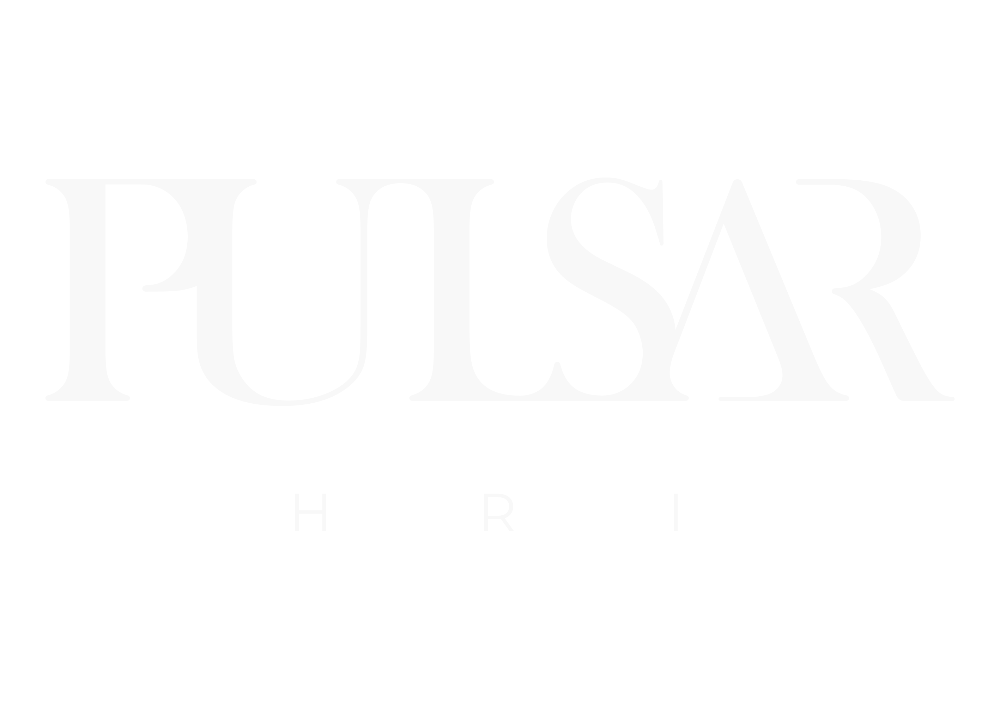

<h1 class="pulsar-visually-hidden">PulsarHRI Developer Hub</h1>

  
  

# Build with PulsarHRI

The PulsarHRI Developer Hub brings together the hardware, software, control, and simulation information needed to build robotics systems with PULSE actuators.

## Choose your path

| I want to… | Start here |
| --- | --- |
| Move one physical actuator without writing code | [Single actuator with Pulsar App](quickstart/pulsar_app.md) |
| Control one physical actuator from Python | [Single actuator with Pulsar SDK](quickstart/sdk_usb.md) |
| Control several actuators over CAN FD | [Multiple actuators with Pulsar SDK](quickstart/sdk_can.md) |
| Develop without physical hardware | [Virtual actuator with Pulsar SDK](quickstart/sdk_virtual.md) |
| Design a robot integration | [Hardware](hardware/index.md) and [AUGUR Digital Twin](augur/index.md) |

## Main areas

### Hardware

Mount and power an actuator, understand its interfaces, and connect by USB or CAN FD.

[Explore hardware](hardware/index.md)

### Firmware

Learn how the Pulsar App checks for firmware releases and access the current update portal.

[Explore firmware](firmware/index.md)

### Pulsar App

Use the browser or desktop GUI to configure, command, and inspect one physical actuator.

[Open the Pulsar App documentation](pulsar_app/index.md)

### Pulsar SDK

Build Python applications for physical and virtual actuators, from one device to multi-domain robot platforms.

[Explore Pulsar SDK](sdk/index.md)

### AUGUR Digital Twin

Run validated virtual actuator models and couple them to external robot simulators.

[Explore AUGUR Digital Twin](augur/index.md)

### Control architectures

Understand torque, velocity, position, and impedance control and the parameters available in each mode.

[Explore control architectures](control_architectures/index.md)

!!! note "Rust SDK"
    The Pulsar Rust SDK will follow the same user-facing concepts as Pulsar SDK for Python. Its documentation and examples are coming soon.

## Compatibility at a glance

- Physical SDK firmware requirement: **2.0.4 or newer**.
- Supported hosts: **Linux x86_64**, **Linux ARM64**, and **Windows x86_64**.
- Supported Python versions: **3.10–3.13**.
- macOS is not currently supported.
- The Pulsar App controls one physical actuator at a time.

Need help? Visit [Support](support.md) or [FAQ and Issues](faq_issues.md).
