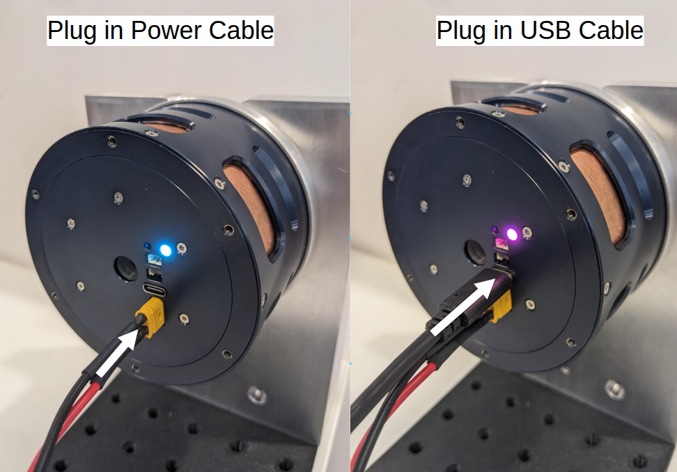

# Single actuator with Pulsar App

This is the fastest way to move one physical PULSE actuator without writing code.

## What you need

- one securely mounted PULSE actuator;
- a suitable 48 V DC power supply and power cable;
- a USB-A to USB-C cable;
- Chrome or another Chromium-based browser on Linux or Windows.

Read [Safety and prerequisites](../hardware/safety.md) before continuing.

## Connect the actuator

1. Mount the actuator so it cannot move unexpectedly as a whole.
2. Connect the power cable and switch on the power supply.
3. Confirm that the [status LED](../hardware/led.md) turns on.
4. Connect the actuator directly to the computer by USB.
5. Confirm that the LED indicates a USB connection.

{ width="60%" }

## Open Pulsar App

1. Open [https://app.pulsarhri.com/](https://app.pulsarhri.com/).
2. Allow the browser to access the connected serial device.
3. Select the actuator in **Devices**. Use refresh if it is not listed.

!!! warning
    Once connected and enabled, commands can cause immediate motion. Keep people, cables, tools, and loose objects outside the operating area.

## Try velocity control

1. Select **Speed Control**.
2. Confirm that the setpoint is `0 rad/s`.
3. Press **Play**.
4. Increase the setpoint gradually and observe the actuator and live plot.
5. Return the setpoint to zero before changing mode.

## Try position control

1. Select **Position Control**.
2. Press **SET 0 POSITION** to use the current output position as zero.
3. Press **Play** while the setpoint is zero.
4. Change the position setpoint by a small amount and observe the response.

Change gains and limits only in small increments. A gain that is too high can produce overshoot or unstable motion.

## Next steps

- [Pulsar App overview](../pulsar_app/index.md)
- [Single actuator with Pulsar SDK](sdk_usb.md)
- [Control architectures](../control_architectures/index.md)
- [CAN FD connectivity](../hardware/connectivity/can.md)
