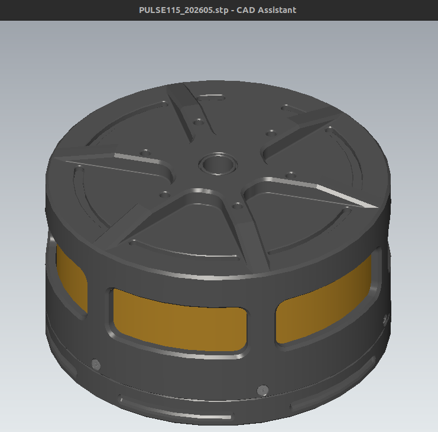
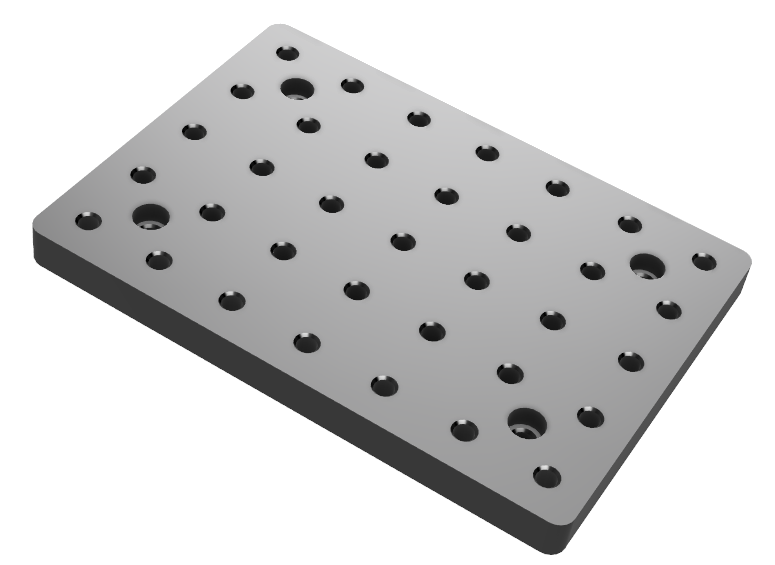
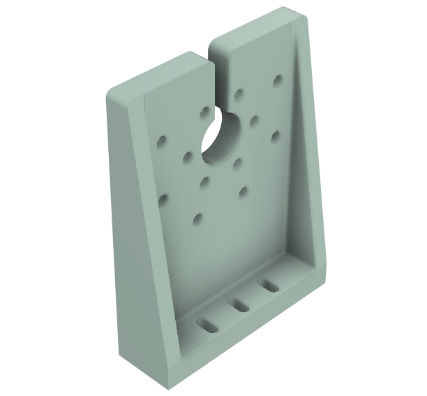
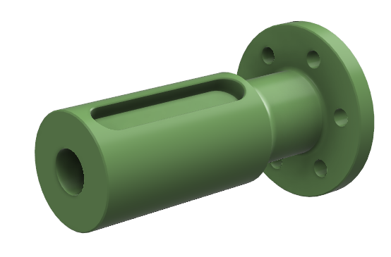

# Mechanical CAD and printable fixtures

## Actuator assemblies

| Model | Preview | Format | Download |
| --- | --- | --- | --- |
| PULSE115 merged assembly | { width="180" loading=lazy } | STEP | [Download](../assets/3d_models/PULSE115_202605.stp) |
| PULSE98 merged assembly | Coming soon | STEP | Coming soon |

## Printable fixtures

| Part | Preview | Download |
| --- | --- | --- |
| Base | { width="180" } | [STL](../assets/3d_models/base.stl) |
| PULSE115 bracket | { width="180" } | [STL](../assets/3d_models/bracket_pulse115.stl) |
| PULSE98 bracket | { width="180" } | [STL](../assets/3d_models/bracket_pulse98.stl) |
| Shaft | { width="180" } | [STL](../assets/3d_models/shaft.stl) |

Use these files for fit checks and initial fixtures. Validate material, fasteners, loads, and safety factors for the intended application.
