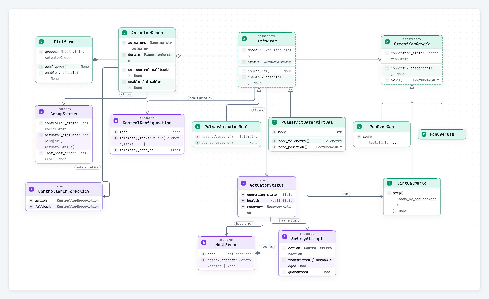
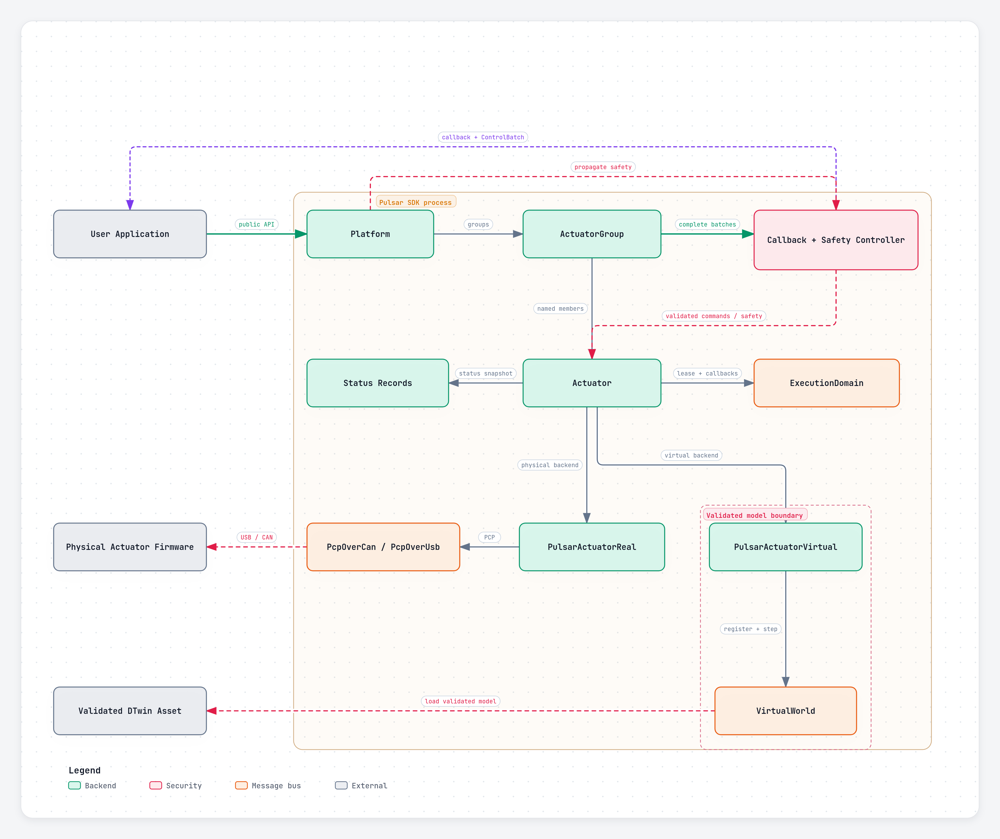

Pulsar Python SDK
{ .pulsar-home-eyebrow }

# Core concepts and workflow

Pulsar Python SDK uses four layers: an execution **domain** owns communication or simulation time, an **actuator** represents one physical or virtual device, a **group** coordinates actuators that run together, and a **platform** coordinates groups across a complete robot.

You only need the layers that match the application. A single actuator can be used directly; groups and platforms become useful as the system grows.

## Object model



| Concept | Responsibility | Important boundary |
| --- | --- | --- |
| `ExecutionDomain` | Owns one transport or simulation clock, its callback worker, telemetry watchdog, and connected actuator leases. | One direct USB link, one USB-to-CAN adapter, or one virtual simulation clock. |
| `Actuator` | Represents one physical or virtual actuator and exposes lifecycle, commands, telemetry, parameters, and status. | Belongs to exactly one domain and at most one active group. |
| `ActuatorGroup` | Gives stable names to actuators controlled in one mode and one domain. It coordinates lifecycle, complete telemetry batches, callbacks, and group safety. | Every member must share the same domain and control mode. |
| `Platform` | Coordinates named groups as one application-level robot. It can connect, configure, enable, disable, and recover them together. | May span domains, but does not merge their telemetry or synchronize their clocks. |

### Execution domains are resource boundaries

Choose a domain from the connection being controlled:

| Domain | Owns |
| --- | --- |
| `PcpOverUsb` | one direct-USB actuator at address `0` |
| `PcpOverCan` | one USB-to-CAN adapter and the actuator addresses on its bus |
| `VirtualWorld` | one deterministic simulation clock and its virtual actuators |

A connected actuator holds a lease on its domain. Calling `domain.disconnect()` while an actuator still uses it raises `ResourceBusyError`; disconnect or close the actuator or group first.

Domains are also callback and timing boundaries. One worker handles callbacks for each domain, and each `VirtualWorld` advances on its own simulation clock.

### Physical and virtual actuators

`PulsarActuatorReal` and `PulsarActuatorVirtual` share the same lifecycle, modes, commands, grouping, callbacks, parameters, and status model.

| Physical actuator | Virtual actuator |
| --- | --- |
| Communicates through `PcpOverUsb` or `PcpOverCan`. | Runs an AUGUR Digital Twin model inside `VirtualWorld`. |
| State changes complete after the requested state is reported by the device. | State and telemetry advance deterministically when the world steps. |
| Uses address `0` on direct USB or a unique CAN address. | Uses a unique address within its virtual world. |
| Communication loss means the physical state is unknown. | Simulation time and model state remain owned by the application. |

Backend-specific operations are reported through `Capability` and `FeatureResult`; applications can check support without changing the common workflow.

### Groups and platforms

Use an `ActuatorGroup` when actuators share a domain and should be configured, enabled, commanded, and protected together. Member names and mappings are read-only for the life of the group. Closing a group detaches its actuators so they can be placed in another group.

Use a `Platform` when an application has several groups, including groups on different CAN adapters or a mixture of physical and virtual domains. A platform coordinates lifecycle and propagates active safety, but each group still receives telemetry and runs callbacks independently.

```python
from pulsar_sdk import ActuatorGroup, PcpOverCan, Platform, PulsarActuatorReal

right_can = PcpOverCan("<right-adapter-port>")
left_can = PcpOverCan("<left-adapter-port>")

right_arm = ActuatorGroup(
    "right_arm",
    {
        "shoulder": PulsarActuatorReal(right_can, address=23),
        "elbow": PulsarActuatorReal(right_can, address=24),
    },
)
left_arm = ActuatorGroup(
    "left_arm",
    {
        "shoulder": PulsarActuatorReal(left_can, address=23),
        "elbow": PulsarActuatorReal(left_can, address=24),
    },
)

robot = Platform({"right_arm": right_arm, "left_arm": left_arm})
```

Replace the port placeholders with values returned by `PcpOverCan.list_ports()`. The repeated addresses are valid because each CAN adapter is a separate domain.

### Names, commands, telemetry, and units

SDK types use `PascalCase`; methods, arguments, and fields use `snake_case`. A value sent to an actuator is a **command**, while a value reported by an actuator or model is **telemetry**.

Physical quantities use SI units unless a name states otherwise, such as `_ms` for milliseconds or `_hz` for hertz. The primary command unit depends on the configured control mode.

## Core workflow

Constructors validate names, addresses, and membership, but perform no I/O. Connection and model loading happen when `connect()` is called or a context manager is entered.



### Recommended order

1. Construct domains, actuators, groups, and optionally a platform.
2. Connect or enter the object's context manager.
3. Configure the control mode and periodic telemetry.
4. Optionally zero position.
5. Register telemetry, control, or diagnostic callbacks.
6. Enable drive output.
7. Send commands or run the application controller.
8. Disable before changing mode, changing writable parameters, or shutting down.
9. Disconnect or exit the context manager.

### One physical actuator

```python
from pulsar_sdk import ControlConfiguration, Mode, PcpOverUsb, PulsarActuatorReal

actuator = PulsarActuatorReal(PcpOverUsb(), address=0)

with actuator:
    actuator.configure(ControlConfiguration(Mode.VELOCITY))
    actuator.enable()
    actuator.set_command(0.5)  # rad/s
    actuator.disable()
```

Entering the context manager connects the actuator and acquires its domain. Exiting attempts a safe disconnect and releases the domain lease.

### Configuration

```python
from pulsar_sdk import ControlConfiguration, Mode, TelemetryItems

configuration = ControlConfiguration(
    mode=Mode.POSITION,
    telemetry_items=(
        TelemetryItems.POSITION,
        TelemetryItems.VELOCITY,
        TelemetryItems.TIMESTAMP_MS,
    ),
    telemetry_rate_hz=500,
)
```

A configuration accepts at most 12 unique telemetry items. The periodic rate is `0` to disable periodic telemetry or `1..10_000` Hz. Configuration does not enable drive output.

### Commands and units

| Mode | Primary command |
| --- | --- |
| `Mode.TORQUE` | torque in N·m |
| `Mode.VELOCITY` | angular velocity in rad/s |
| `Mode.POSITION` | position in rad |
| `Mode.IMPEDANCE` | position in rad, with optional impedance fields |

Commands must be finite and are effective only in `DRIVE_ACTIVE`. See [Commands and parameters](commands_parameters.md) for command mappings, batches, and stored parameters.

### Lifecycle ownership

When an actuator belongs to a group, lifecycle operations such as `configure()`, `enable()`, `disable()`, `clear_faults()`, `recover()`, and `resume()` route through the group. This prevents one member from silently changing shared group state.

A platform applies lifecycle operations to its groups in order and attempts safety-critical cleanup across all affected groups before reporting an aggregate failure. These operations are coordinated, not transactional: a transport failure can occur after an earlier actuator or group was updated.

## Shutdown and unknown state

`disable()` enters `CONFIG_AND_TELEM`: drive output is inactive while runtime telemetry remains available. Explicit physical disconnect then attempts to reach and observe `INIT_CONFIG` before releasing the transport.

Do not rely on Python object destruction for hardware safety. Use `disable()` and `disconnect()`, or the context-manager forms of actuators, groups, and platforms.

!!! warning
    If communication is lost, the physical actuator state is unknown. Software cannot confirm that unreachable hardware is safe.

## Next steps

- [Groups and platforms](groups_platforms.md)
- [Telemetry and callbacks](telemetry_callbacks.md)
- [Lifecycle and recovery](lifecycle_recovery.md)
- [Examples](examples.md)
- [API reference](api_reference.md)
