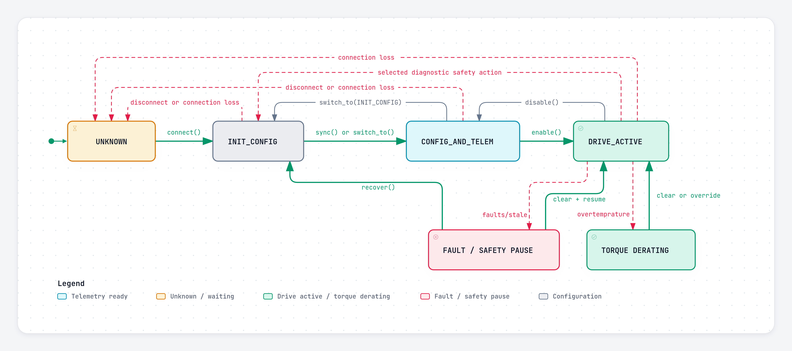
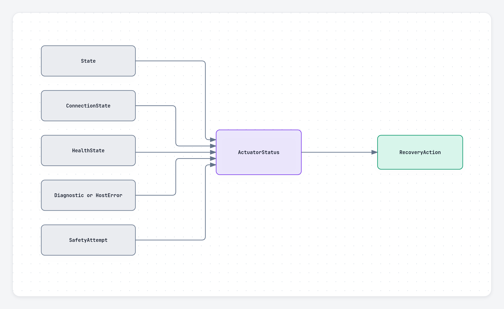

Pulsar Python SDK
{ .pulsar-home-eyebrow }

# Lifecycle and recovery

Operating state, connection state, and health are separate facts. Use `Actuator.status` and `GroupStatus` rather than inferring safety from one boolean.

## Operating states

| State | Meaning |
| --- | --- |
| `UNKNOWN` | disconnected or not observed; cannot be requested |
| `INIT_CONFIG` | output and runtime telemetry inactive; configuration allowed |
| `CONFIG_AND_TELEM` | telemetry active; drive output inactive |
| `DRIVE_ACTIVE` | commands can affect output |

A successful connection ends in `INIT_CONFIG`. `configure()` and `set_mode()` are allowed only in `INIT_CONFIG` or `CONFIG_AND_TELEM`; neither enables output. `sync()` first enters `CONFIG_AND_TELEM` where needed, then resets telemetry timing for the whole domain.

`enable()` requires a complete configuration, checks current diagnostics, synchronizes the domain when required, and enters `DRIVE_ACTIVE`. `disable()` returns to `CONFIG_AND_TELEM`, where telemetry remains available while output is inactive.

`zero_position()` is allowed in `CONFIG_AND_TELEM` or `DRIVE_ACTIVE`. In position and impedance modes, the SDK also resets the primary command to zero to avoid sudden motion. Changing mode clears the primary command and command-scoped feedforward or impedance references; configured gains remain in place.

## Status

`Actuator.status` reports:

- current and last observed operating state;
- connection state;
- `HEALTHY`, `HOST_FAULT`, or `ACTUATOR_FAULT`;
- retained device diagnostics and host errors;
- the last safety attempt;
- peer inhibition;
- recommended recovery action.

## Default controller safety

The default `ControllerErrorPolicy` selects a mode-specific action:

| Mode | Default action |
| --- | --- |
| position | hold an available position; otherwise zero and command zero |
| impedance | hold position; otherwise damped release |
| velocity | command zero velocity |
| torque | enter output-inactive state, switch to velocity, re-enable through the safety path, and command zero velocity |

If the selected action fails, the default fallback requests `INIT_CONFIG`. Command-based hold, damping, and zero-command actions are best effort because they have no operation-specific device acknowledgement.

Safety applies only while output is active. Diagnostics received while output is inactive are retained and checked before a later enable, but they do not energize output or send active hold commands.

## Device diagnostics

Named `DiagnosticFlag` values are exposed instead of raw bit positions.

Default behavior includes:

- overtemperature → torque derating;
- internal or external encoder error → `INIT_CONFIG`;
- other unmapped errors → default safety;
- unmapped warnings → reported and logged without automatic safety.

An unexpected observed state change pauses the owning group and propagates safety to reachable group peers and, when present, other platform groups. Operations across actuators and domains are not atomic.

Mode-dependent command safety is applied only while output is active. Diagnostics received while output is inactive are retained and checked before a later enable, but they do not send hold or damping commands, switch modes, or energize output.

## Recovery sequences

| Situation | Action |
| --- | --- |
| Connection lost | reconnect; the previous physical state is unknown |
| Stale telemetry or controller fault | fix the cause, call `clear_faults()`, then `resume()` |
| Diagnostic handled while output remains active | wait for it to clear, call `clear_faults()`, then `resume()` if paused |
| Diagnostic safety entered `INIT_CONFIG` | clear the physical condition, call `recover()`, then `resume()` or `enable()` |

`clear_faults()` verifies current diagnostics and returns `False` while a mapped condition remains active. `recover()` is only for diagnostic safety that selected `INIT_CONFIG`; it is not a general host-fault clear operation.

## Advanced policies

`ControllerErrorPolicy`, diagnostic action mappings, damping, and explicit diagnostic overrides are documented in the [API reference](api_reference.md#controllererrorpolicy).

!!! danger
    `ControllerErrorAction.DO_NOTHING` and `override_diagnostic_safety()` can suppress automatic safety behavior. Use them only for a controlled, reviewed application with an independent safety plan.

## Connection loss and shutdown

After transport loss, the SDK reports `UNKNOWN` and preserves the previous observation in `status.last_operating_state`. It does not claim that unreachable hardware is safe.

Explicit physical disconnect attempts to reach and observe `INIT_CONFIG` before releasing the transport. It raises when the SDK cannot confirm that state. Do not rely on Python object destruction for hardware safety; use `disable()` and `disconnect()`, or a context manager.
