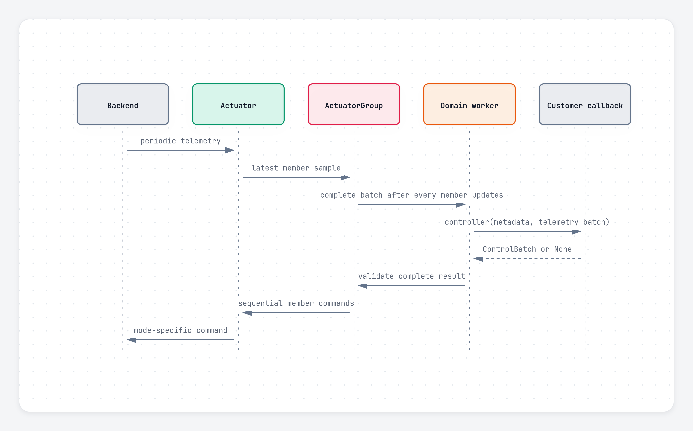

Pulsar Python SDK
{ .pulsar-home-eyebrow }

# Telemetry and callbacks

Pulsar Python SDK supports direct telemetry reads, actuator callbacks, complete group controller batches, and platform-wide callback registration.

## Configure periodic telemetry

```python
from pulsar_sdk import ControlConfiguration, Mode, TelemetryItems

configuration = ControlConfiguration(
    mode=Mode.POSITION,
    telemetry_items=(
        TelemetryItems.POSITION,
        TelemetryItems.VELOCITY,
        TelemetryItems.TIMESTAMP_MS,
    ),
    telemetry_rate_hz=500,
)
```

At most 12 unique telemetry items may be configured. The effective rate is available as `actual_telemetry_rate_hz`.

## Read a snapshot

```python
telemetry = actuator.read_telemetry((
    TelemetryItems.POSITION,
    TelemetryItems.VELOCITY,
))
```

Snapshot reads are available in `CONFIG_AND_TELEM` or `DRIVE_ACTIVE`.

## Actuator callback

```python
def on_telemetry(address, telemetry):
    print(address, telemetry[TelemetryItems.POSITION])

actuator.set_telemetry_callback(on_telemetry)
```

One worker per execution domain runs user callbacks away from the transport reader thread. For each callback source, at most one callback runs and one newest pending packet waits. Older pending work may be replaced; inspect `dropped_telemetry_packets`.

## Group controller

A group controller runs after one new sample has arrived from every member:

```python
from pulsar_sdk import ControlParams


def controller(metadata, telemetry):
    return {
        name: {ControlParams.COMMAND: values[TelemetryItems.POSITION]}
        for name, values in telemetry.items()
    }

arm.set_control_callback(controller)
```



Callback output is fully validated before the first member write. Member writes are sequential, so a later transport failure can occur after an earlier command was sent. Callback-path transmission failures latch a `HostError` and apply the configured safety policy.

If the source is stopped, reconfigured, or faulted while the callback runs, its result is discarded. Inspect `dropped_batches` when newer complete group batches replace pending work.

## Platform callback

`Platform.set_control_callback()` registers the same callback on every group. Calls remain independent, may run on different domain workers, and use `metadata.group_name` to identify the source. A platform does not create one cross-domain telemetry batch or synchronize domain clocks.

## Timeouts

An `ActuatorGroup` has two independent timeouts:

- `telemetry_timeout_s`, default `0.1` seconds;
- `controller_timeout_s`, default `1.0` second, or `None` to disable the callback deadline.

The telemetry timeout applies only while callback control is active and periodic telemetry is configured. Stale telemetry or a callback deadline pauses callback control and applies the configured safety policy. Fresh telemetry alone does not clear the retained fault or resume control; fix the cause, call `clear_faults()`, then call `resume()`.

Python cannot cancel a callback thread that exceeds its deadline. Its eventual result is discarded.

## Removing callbacks

Removing a callback from another thread waits for its current invocation to finish. A diagnostic callback cannot replace itself while running; doing so raises `ResourceBusyError`.
