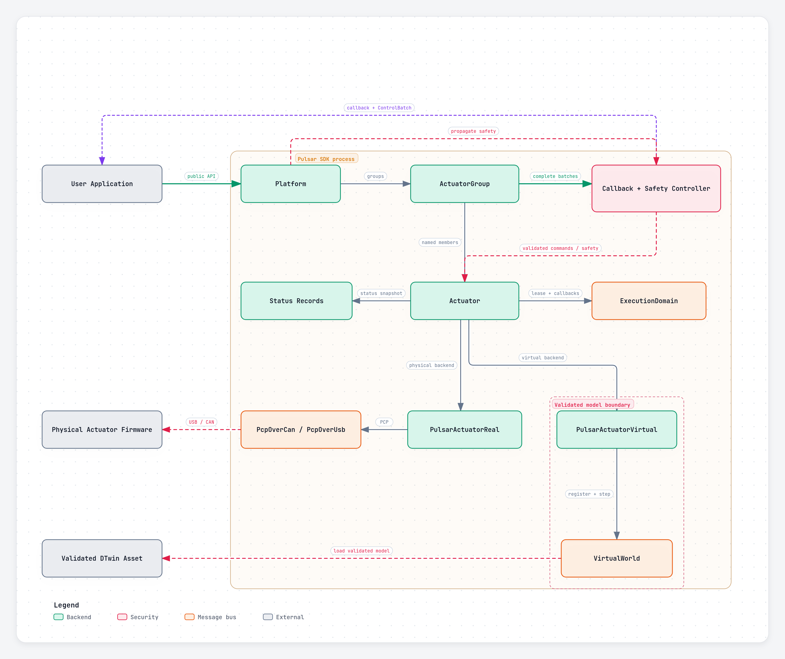
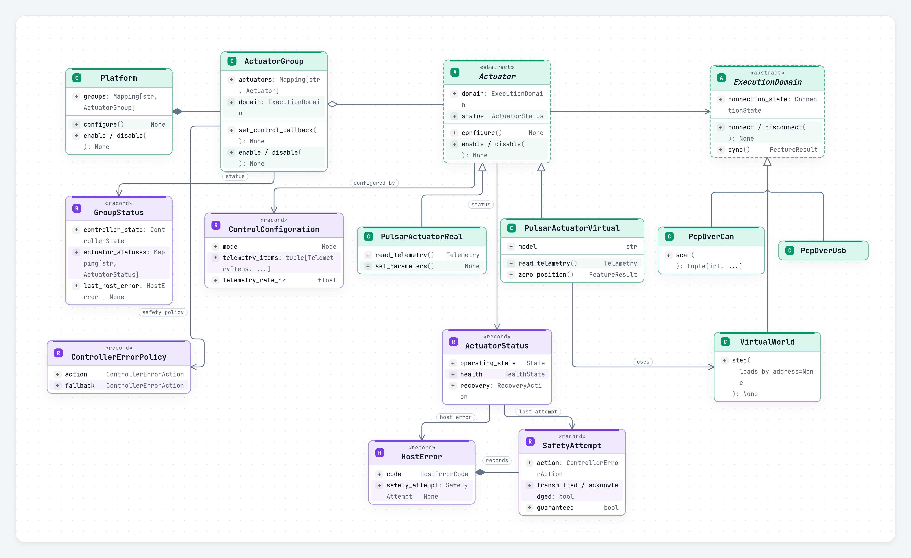
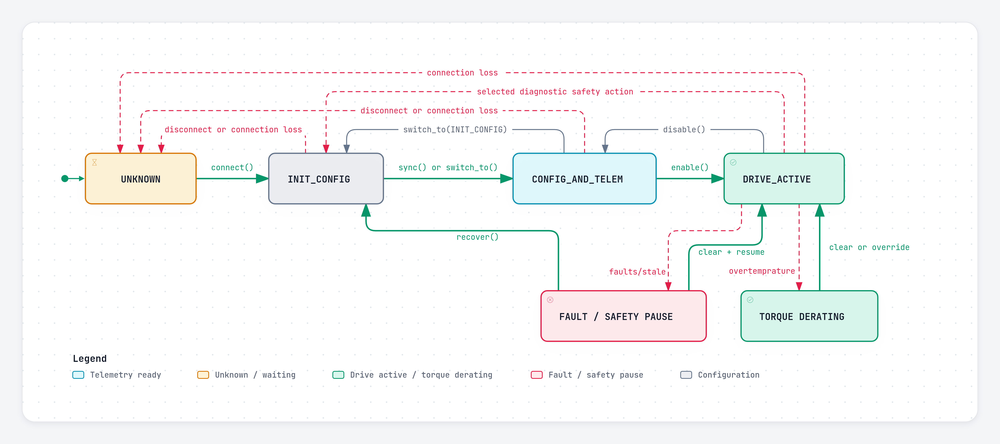
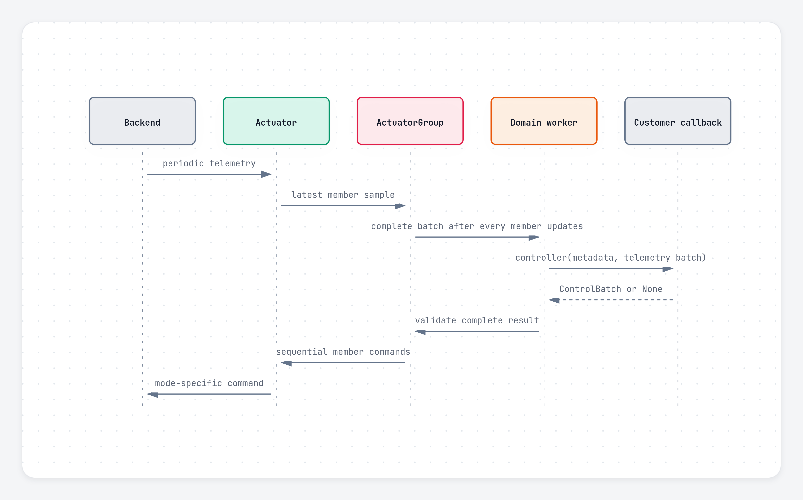
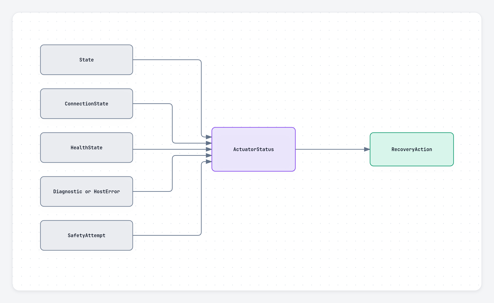

# Pulsar SDK user contract

This guide explains the public behavior of the Python `pulsar_sdk` package. It covers object ownership, lifecycle, control callbacks, safety, and the differences between physical and virtual actuators.

For exact signatures and enum values, see [`api_reference.md`](api_reference.md).

## Diagrams

- [Runtime architecture](assets/diagrams/runtime.png)
- [Public class model](assets/diagrams/class-model.png)
- [Lifecycle and recovery](assets/diagrams/lifecycle.png)
- [Setup, callback, and safety sequence](assets/diagrams/full-sequence.png)

# Core concepts

## Overall runtime diagram


## Object model



- An **actuator** belongs to one `ExecutionDomain`.
- A **group** contains named actuators from exactly one domain. All members use the same control mode.
- An actuator can belong to at most one active group.
- A **platform** contains named groups and may span several domains.
- Group and platform mappings are read-only. Names remain stable for the lifetime of the object.
- Closing a group detaches its actuators so they can be placed in another group.
- A platform coordinates lifecycle and safety. It does not combine telemetry or synchronize clocks across domains.

## Execution domains

An `ExecutionDomain` owns one transport or simulation clock, plus its callback worker and telemetry watchdog.

- `PcpOverCan` represents one USB-to-CAN adapter.
- `PcpOverUsb` represents one direct-USB actuator at address `0`.
- `VirtualWorld` represents one deterministic simulation clock.

Connected actuators hold leases on their domain. Calling `domain.disconnect()` while an actuator still uses it raises `ResourceBusyError`.

## Naming and units

- Types use `PascalCase`; methods and fields use `snake_case`.
- A value sent to an actuator is a **command**.
- Values reported by an actuator or model are **telemetry**.
- Physical values use SI units unless the name states another unit, such as `_ms` or `_hz`.
- The meaning of `COMMAND` depends on `Mode`:
  - `TORQUE`: newton-metres
  - `VELOCITY`: radians per second
  - `POSITION`: radians
  - `IMPEDANCE`: position command in radians, with optional impedance fields

# Basic workflow

Constructors validate names, addresses, and membership, but perform no I/O. Connection and model loading happen in `connect()`.

```python
from pulsar_sdk import (
    ActuatorGroup,
    ControlConfiguration,
    ControlParams,
    Mode,
    PcpOverCan,
    Platform,
    PulsarActuatorReal,
    TelemetryItems,
)


def controller(metadata, telemetry):
    return {
        name: {ControlParams.COMMAND: values[TelemetryItems.POSITION]}
        for name, values in telemetry.items()
    }


right_domain = PcpOverCan("/dev/ttyACM0")
left_domain = PcpOverCan("/dev/ttyACM1")

right_arm = ActuatorGroup(
    "right_arm",
    {
        "shoulder": PulsarActuatorReal(right_domain, 45),
        "elbow": PulsarActuatorReal(right_domain, 40),
    },
)
left_arm = ActuatorGroup(
    "left_arm",
    {
        "shoulder": PulsarActuatorReal(left_domain, 40),
        "elbow": PulsarActuatorReal(left_domain, 45),
    },
)

robot = Platform({"right_arm": right_arm, "left_arm": left_arm})
configuration = ControlConfiguration(
    mode=Mode.IMPEDANCE,
    telemetry_items=(
        TelemetryItems.POSITION,
        TelemetryItems.VELOCITY,
        TelemetryItems.TIMESTAMP_MS,
    ),
    telemetry_rate_hz=500,
)

with robot:
    robot.configure({
        "right_arm": configuration,
        "left_arm": configuration,
    })
    robot.zero_position()
    robot.set_control_callback(controller)
    robot.enable()  # Synchronizes each domain when required.

    # Run the application control loop here.

    robot.disable()
```

Recommended order:

1. Construct domains, actuators, groups, and optionally a platform.
2. Connect.
3. Configure every group.
4. Optionally zero position.
5. Register callbacks.
6. Enable.
7. Disable before changing mode, changing writable parameters, or shutting down.
8. Disconnect or exit the context manager.

Calling `configure()`, `set_mode()`, `switch_to()`, `sync()`, `enable()`, `disable()`, `clear_faults()`, `recover()`, or `resume()` through an actuator that belongs to a group applies the operation through its group. This prevents one member from silently changing the group lifecycle by itself.

# Lifecycle



| State | Meaning |
| --- | --- |
| `UNKNOWN` | The actuator is disconnected or its physical state is not known. This state cannot be requested. |
| `INIT_CONFIG` | Drive output and runtime telemetry are inactive. Configuration and parameter changes are allowed. |
| `CONFIG_AND_TELEM` | Telemetry is available and drive output is inactive. |
| `DRIVE_ACTIVE` | Commands can affect actuator output. |

Important behavior:

- A successful connection ends in `INIT_CONFIG`.
- `configure()` and `set_mode()` are allowed only in `INIT_CONFIG` or `CONFIG_AND_TELEM`. They do not enable output.
- `sync()` moves an actuator from `INIT_CONFIG` to `CONFIG_AND_TELEM` before resetting its domain telemetry clock.
- `enable()` requires a complete configuration. It enters `CONFIG_AND_TELEM`, checks current diagnostics, synchronizes the domain when needed, then enters `DRIVE_ACTIVE`.
- `disable()` enters `CONFIG_AND_TELEM`, so telemetry remains available.
- `zero_position()` is allowed in `CONFIG_AND_TELEM` or `DRIVE_ACTIVE`; position and impedance reset the COMMAND to zero to avoid sudden motion.
- After transport loss, the SDK reports `UNKNOWN` and preserves the previous observation in `status.last_operating_state`. It does not claim that the unreachable actuator is safe.
- An unexpected observed state change pauses the owning group and propagates safety through its platform.
- Explicit physical disconnect tries to reach and observe `INIT_CONFIG`. It raises if a safe state cannot be confirmed.

Mode changes clear the primary command and command-scoped feedforward or impedance references. Configured gains remain in place.

# Configuration and commands

```python
ControlConfiguration(
    mode: Mode,
    telemetry_items: tuple[TelemetryItems, ...] = (),
    telemetry_rate_hz: float = 0.0,
)
```

Rules:

- At most 12 unique telemetry items may be configured.
- The rate is `0` to disable periodic telemetry, or a value from `1` to `10_000` Hz.
- `actual_telemetry_rate_hz` reports the rate produced by the 20 kHz divider.
- Current virtual models require `VirtualWorld(time_step_hz=20_000)`.

A standalone actuator accepts either the primary value or the same mode-specific mapping used by batches:

```python
actuator.set_command(value)
actuator.set_command({
    ControlParams.COMMAND: value,
    ControlParams.VELOCITY_KP: kp,
})
```

A group command batch has this shape:

```python
{
    "actuator_name": {
        ControlParams.COMMAND: value,
        # Optional mode-specific control fields
    }
}
```

- A batch may select only part of a group or platform. Omitted actuators keep their previous device command.
- Every selected actuator must include `ControlParams.COMMAND`.
- `COMMAND` must be finite.
- Optional gain fields may be `NaN` to keep their current value.
- The complete batch is validated before the first write.
- Member writes are sequential. A later transport failure can occur after earlier members were updated.
- Direct batch failures raise `CommandTransmissionError`; `successful_members` lists writes that completed before the failure.
- Callback-path transmission failures latch a `HostError` and run the configured safety policy.
- A callback result is discarded if its source was stopped, reconfigured, or faulted while the callback was running.

Parameter and gain-preset updates also run per actuator and are not transactional. `unify=True` applies one parameter map or preset to all represented actuators. Commands never use `unify=True`.

# Telemetry and callbacks



- An actuator telemetry callback receives `(address, telemetry)`.
- A group controller receives one new sample from every member.
- A platform callback runs independently for each group. `metadata.group_name` identifies the source.
- One callback worker is shared by each domain. User callbacks do not run on the transport reader thread.
- For each callback source, at most one callback runs and one newest pending item waits. Older pending work may be replaced.
- `dropped_telemetry_packets` and `dropped_batches` report replacements.
- Removing a callback from another thread waits for its current invocation to finish.
- A diagnostic callback cannot change itself; doing so raises `ResourceBusyError`.

## Stale telemetry and callback deadlines

`ActuatorGroup` has two independent timeouts:

- `telemetry_timeout_s` defaults to `0.1` seconds. It applies when callback control is active and periodic telemetry is configured.
- `controller_timeout_s` defaults to `1.0` second. Set it to `None` to disable the callback deadline.

When telemetry becomes stale, the group pauses callback control and applies `DEFAULT_SAFETY`. Fresh telemetry does not clear the recorded fault or resume control automatically.

When a callback exceeds its deadline, its eventual result is discarded. Python does not cancel the running callback thread.

## Virtual stepping

`VirtualWorld.step()`:

1. Finds the earliest next periodic telemetry event among connected virtual actuators.
2. Applies the supplied loads for the required internal model ticks.
3. Steps connected models in registration order.
4. Delivers due telemetry.
5. Waits for due actuator and group callbacks.
6. Returns after callback commands are stored for the next public step.

If no periodic telemetry is configured, one call advances one internal model tick.

# Status, safety, and recovery

Operating state, connection state, and health are separate facts.



`Actuator.status` is the single actuator state/status property. It reports:

- current and last observed operating state;
- connection state;
- `HEALTHY`, `HOST_FAULT`, or `ACTUATOR_FAULT`;
- retained device diagnostics and host errors;
- the last `SafetyAttempt`;
- whether a healthy actuator is inhibited by another member;
- recovery guidance.

`GroupStatus` adds controller state, stale member names and addresses, dropped batches, timestamp skew, and one status snapshot per actuator.

## Default safety policy

`ControllerErrorPolicy()` defaults to:

```python
ControllerErrorPolicy(
    action=ControllerErrorAction.DEFAULT_SAFETY,
    damping=None,
    fallback=ControllerErrorAction.INIT_CONFIG,
)
```

`DEFAULT_SAFETY` selects an action from the current mode:

| Mode | Default action |
| --- | --- |
| `POSITION` | Hold an available/cached position; otherwise zero position and send command zero. |
| `IMPEDANCE` | Hold an available/cached position; otherwise damped release using configured damping or `10`. |
| `VELOCITY` | Send zero velocity. |
| `TORQUE` | Quickly enter `CONFIG_AND_TELEM`, switch to velocity, re-enter `DRIVE_ACTIVE` through the safety path, and send zero velocity. |

These command actions are best effort. They can confirm that transmission succeeded, but they do not have an operation-specific device acknowledgement. State-changing actions are guaranteed only when the requested state is observed. A failed default action falls back to `INIT_CONFIG`. Torque safety intentionally leaves the actuator configured in velocity mode after a successful quick switch.

Mode-dependent command safety is applied only while the actuator is in `DRIVE_ACTIVE`. Diagnostics received while output is inactive are retained and still participate in later enable checks, but they do not send hold/damping commands, quick-switch modes, energize output, or propagate active safety to peers.

Safety propagates to reachable peers in the group and, when a platform is present, to its other groups. Operations are not atomic across actuators or domains.

## Device diagnostics

Firmware diagnostics are public `DiagnosticFlag` enum values, so applications use names rather than raw bit numbers:

```python
from pulsar_sdk import ControllerErrorAction, DiagnosticFlag


diagnostic_actions = {
    DiagnosticFlag.BUS_VOLTAGE_OUT_OF_RANGE: ControllerErrorAction.HOLD_POSITION,
    DiagnosticFlag.INTERNAL_ENCODER_ERROR: ControllerErrorAction.INIT_CONFIG,
}
```

- Unmapped warnings are reported and logged without an automatic safety action.
- `OVERTEMPERATURE` defaults to `LIMIT_TORQUE`. On physical actuators, the SDK applies torque derating while the warning is active.
- `INTERNAL_ENCODER_ERROR` and `EXTERNAL_ENCODER_ERROR` default to `INIT_CONFIG`.
- Other unmapped error diagnostics use `DEFAULT_SAFETY`.
- `diagnostic_actions` can assign a `ControllerErrorAction` to any named diagnostic.
- `DO_NOTHING` makes a mapped diagnostic report-only: callbacks and status still update, but it does not fault, inhibit, pause, propagate safety, block enable, or block direct commands.
- `diagnostic_damping` supplies the damping value when a diagnostic selects `DAMPED_RELEASE`. Very high damping approaches a position hold; very low damping approaches free motion.

For explicit passive diagnostics, every diagnostic can use the existing mapping interface:

```python
diagnostic_actions = {
    flag: ControllerErrorAction.DO_NOTHING
    for flag in DiagnosticFlag
}
```

For a group controller, `ControllerErrorPolicy(action=DO_NOTHING, fallback=DO_NOTHING)` logs callback/controller failures, retains the last host error for inspection, keeps the previous command, and continues later callback cycles. It does not suppress validation or transmission exceptions raised directly by `set_command()`, `set_commands()`, or platform `set_commands()`.

`override_diagnostic_safety(flags)` is an explicit bypass for currently active `DiagnosticFlag` values. Overrides expire when those diagnostics clear. Overriding `OVERTEMPERATURE` restores the previous torque limit.

## Recovery operations

| Situation | Required action |
| --- | --- |
| Connection lost | Reconnect. The previous physical state is unknown. |
| Stale telemetry or controller fault | Fix the cause, call `clear_faults()`, then `resume()`. |
| Device diagnostic handled while output remains active | Wait for the condition to clear, call `clear_faults()`, then `resume()` if callback control was paused. |
| Diagnostic action entered `INIT_CONFIG` | Clear the physical condition, call `recover()`, then `resume()` or `enable()`. |

`clear_faults()` verifies current named diagnostics. It returns `False` while a mapped warning or error is still active. It also restores the thermal torque limit after `OVERTEMPERATURE` clears.

`recover()` is not a general fault-clear method. It is only valid after a diagnostic safety action selected `INIT_CONFIG`.

# Physical and virtual behavior

Both actuator backends share lifecycle, modes, commands, grouping, callbacks, parameters, and status. Backend-specific features are exposed through `Capability` and `FeatureResult`.

## Physical actuators

- State changes complete only after the requested state is reported.
- CAN addresses must be unique within one `PcpOverCan` domain and lie in `16..16382`.
- Direct USB supports one actuator at address `0`.
- More than eight registered CAN actuators is allowed, but the SDK logs a telemetry-utilization warning.
- Address change, identify, persistence, bootloader entry, and CAN BRS are physical features.

## Virtual actuators

- Current packaged assets support `P90`, `P100`, `PULSE98-30G`, `PULSE98-55G`, `PULSE115-60G`, and `PULSE115-110G` on supported systems and architectures.
- Omitted addresses are allocated monotonically from `0`; explicit addresses must be unique in `0..16382`.
- Each actuator instance loads an isolated generated-model instance.
- Actuators that are disconnected or have never connected do not participate in stepping and cannot stop other models in the world.
- `INIT_CONFIG` and `CONFIG_AND_TELEM` keep the plant passive but movable under external applied loads from a simulator.
- Telemetry is NOT available in `INIT_CONFIG` although the actuator can still move and update its internal state, this is purely to keep parity with physical actuators, switch to `CONFIG_AND_TELEM` to passively read telemetry without moving.
- `DRIVE_ACTIVE` restores the configured mode.
- Raw or device-only telemetry is unsupported. Virtual `BUS_VOLTAGE` is the model supply voltage, fixed at 48 V.
- Telemetry staleness uses simulation time, so pausing the application or debugger does not fault a paused world.
- Position reset occurs on one world-owned 50 µs tick; every connected actuator advances on that tick and group members reset together.

Coupled robot dynamics belong to the external simulator. `VirtualWorld` models individual actuator plants and applies the external loads supplied by the application. The exact supported MuJoCo ownership, units, sign, timing, inverse-dynamics, and validation scheme is specified in [Co-simulation coupling](../augur/co_sim_coupling.md).

# Validation and cleanup

The SDK validates public trust boundaries before transmission, including:

- enum and mapping types;
- finite commands;
- mode-specific control fields;
- telemetry count and rate;
- writable parameters and correctly signed infinite limits;
- addresses and group membership;
- virtual model assets and supported signals.

Do not rely on Python object destruction for hardware safety. Use `disable()` and `disconnect()`, or use the context-manager forms of domains, actuators, groups, and platforms.
